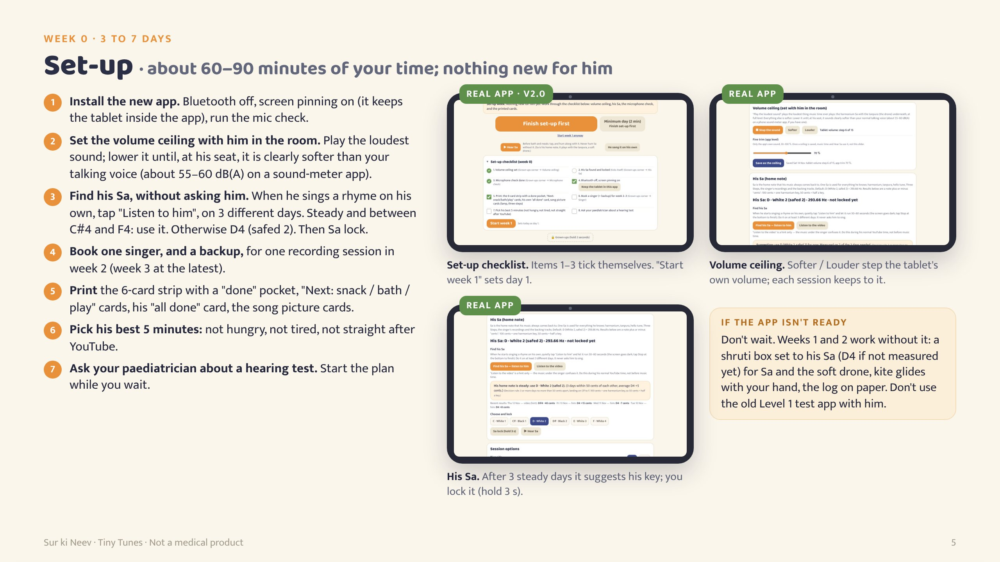
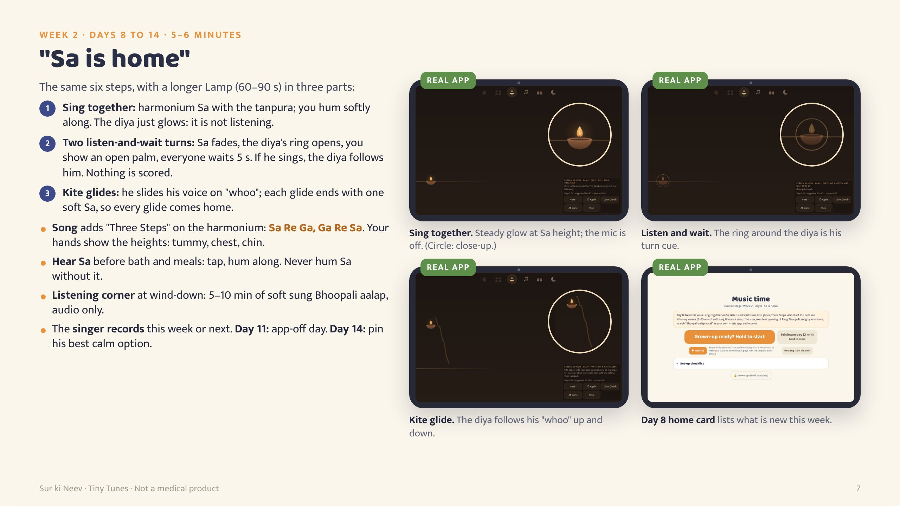
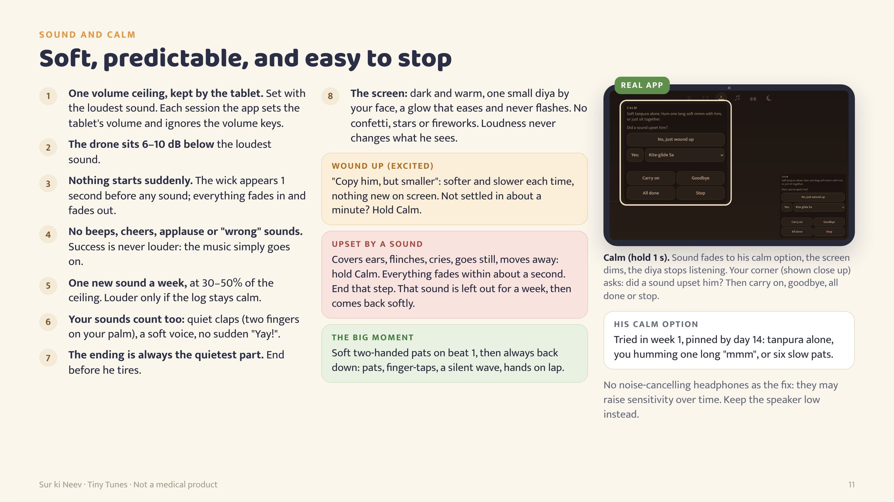
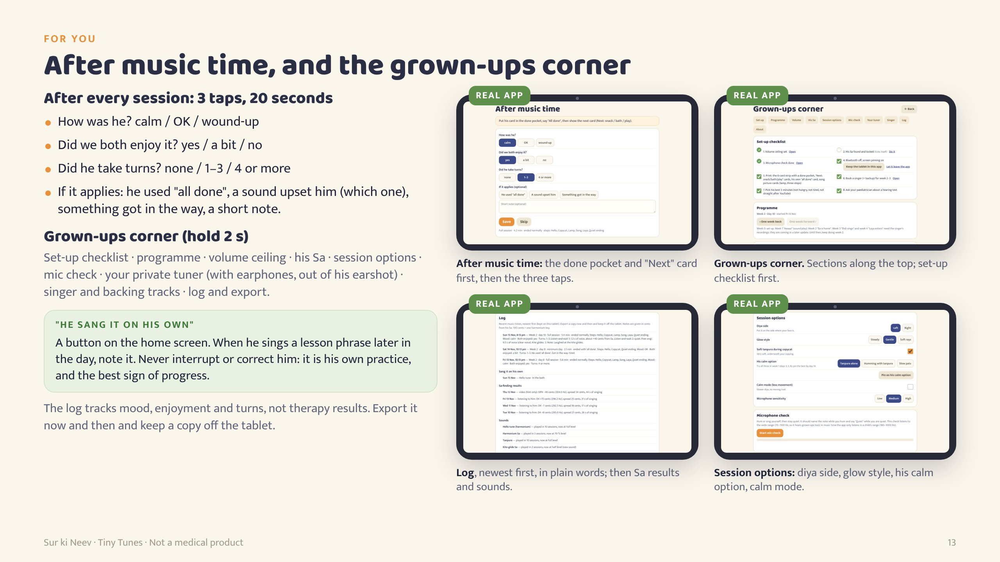
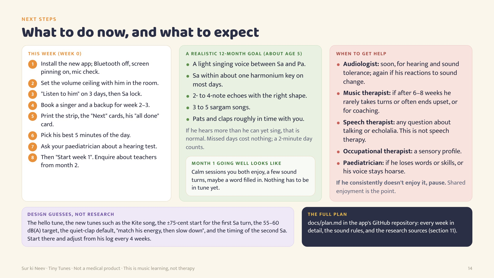

# Sur ki Neev · Riyaz together

The new plan for music time, as slides with screens from the new app (weeks 0 to 2) and planned screens for later weeks. Tap any slide to open it full size.

The full plan, with every detail and the research sources: [plan.md](../plan.md)

The same slides as a PDF: [Sur-ki-Neev.pdf](Sur-ki-Neev.pdf)

## 1 · Sur ki Neev

## 2 · What the research found

## 3 · The approach in one picture

## 4 · The same six steps every day

## 5 · Week 0 · Set-up

## 6 · Week 1 · Awaaz (sound play)

## 7 · Week 2 · Sa is home

## 8 · Weeks 3 and 4 · The singer arrives, then laya (planned)

## 9 · Stages 1 and 2 · about months 1 to 6

## 10 · Stages 3 to 5 and a realistic timeline

## 11 · Sound and calm rules

## 12 · The singer

## 13 · After music time, and the grown-ups corner

## 14 · What to do now, and what to expect

Not a medical product.
