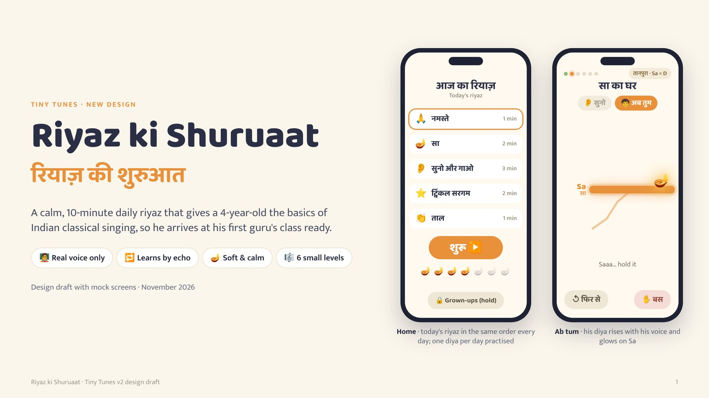
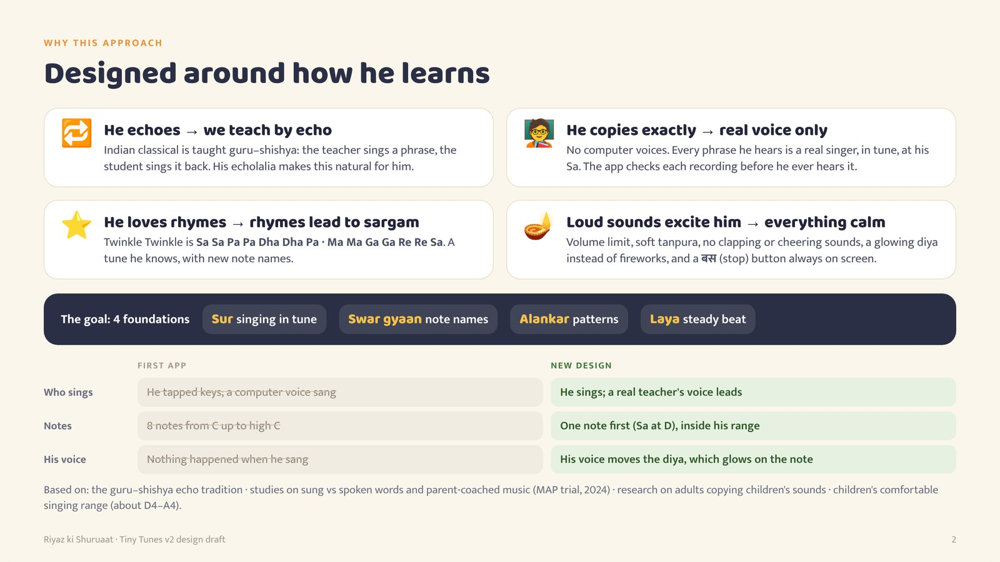
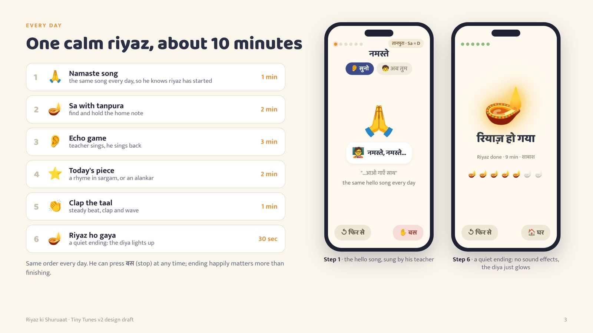
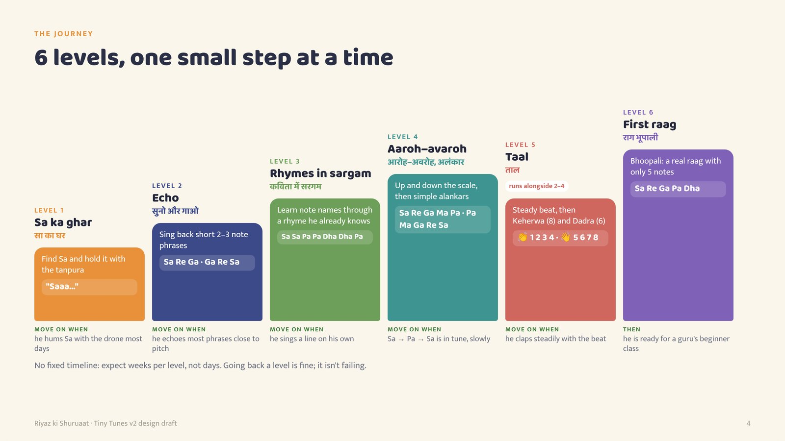
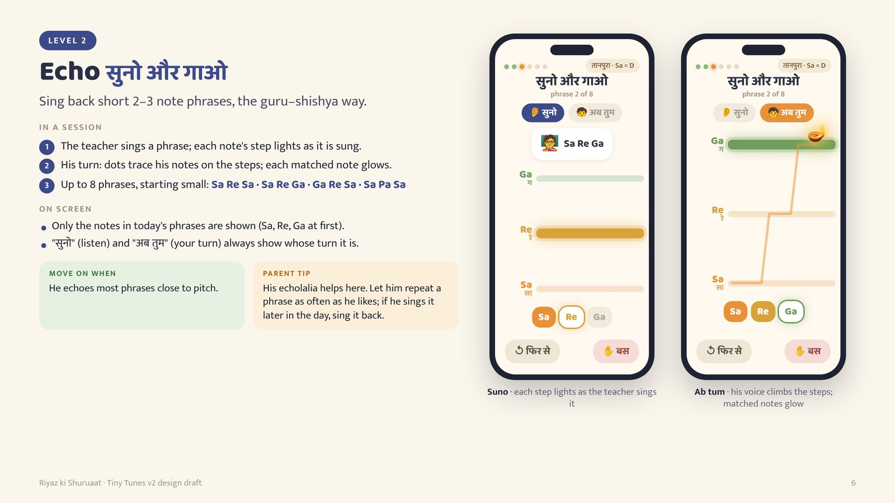
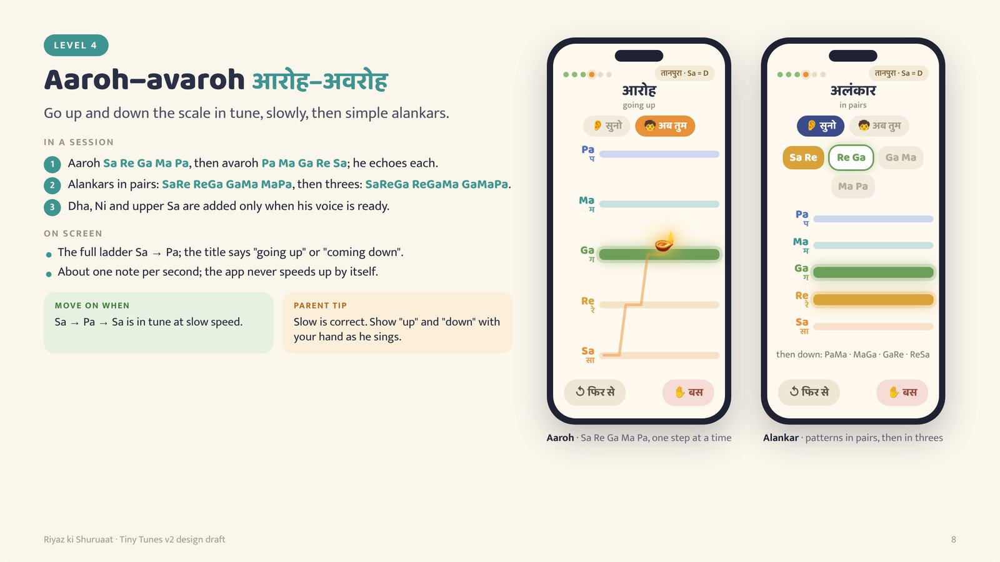
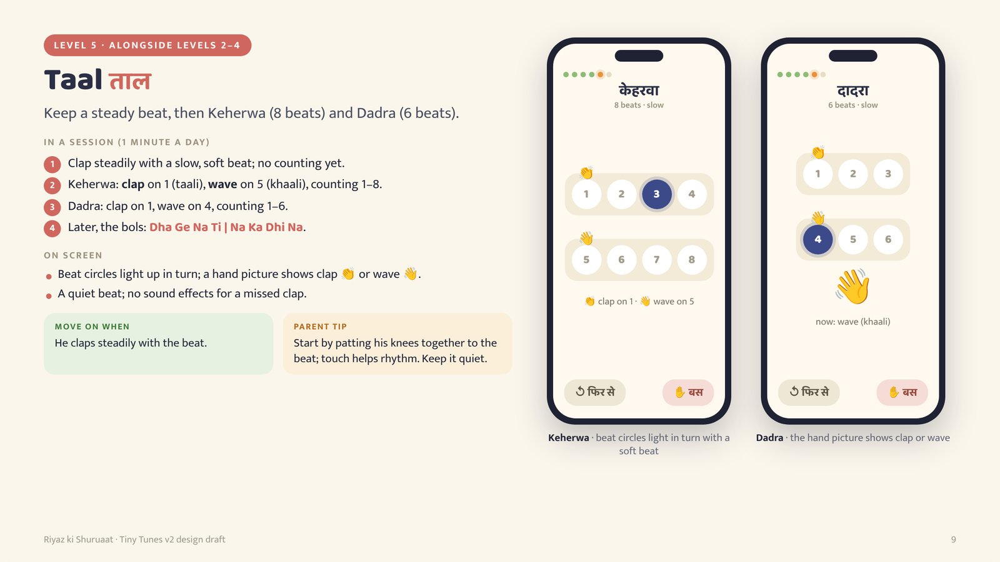
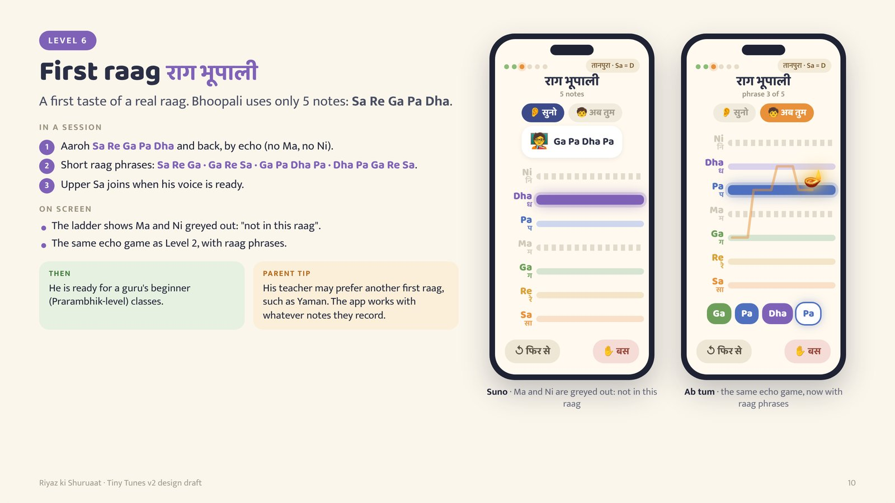
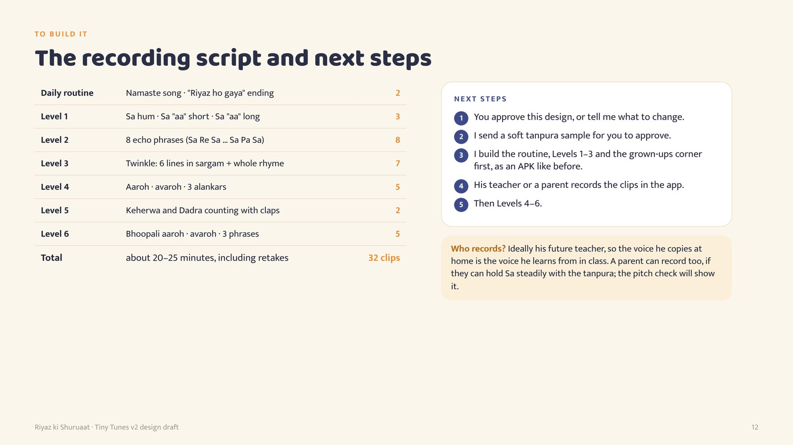

# Riyaz ki Shuruaat · design presentation

Mock screens for the new Tiny Tunes design: a calm daily riyaz that teaches a 4-year-old the basics of Indian classical singing, level by level.

The same slides as a PDF: [Riyaz-ki-Shuruaat.pdf](Riyaz-ki-Shuruaat.pdf)

## 1 · Riyaz ki Shuruaat

## 2 · Designed around how he learns

## 3 · One calm riyaz, about 10 minutes

## 4 · 6 levels, one small step at a time

## 5 · Level 1 · Sa ka ghar (सा का घर)

## 6 · Level 2 · Echo (सुनो और गाओ)

## 7 · Level 3 · Rhymes in sargam (कविता में सरगम)

## 8 · Level 4 · Aaroh–avaroh (आरोह–अवरोह)

## 9 · Level 5 · Taal (ताल)

## 10 · Level 6 · First raag (राग भूपाली)

## 11 · Grown-ups corner

## 12 · The recording script and next steps

