# Tiny Tunes 3: the screens

Screenshots of the real app (version 3, after the review), taken on a computer with recordings of a real child and a real man singing as the "microphone". On the tablet it looks the same.

## 1. First start: turn on the microphone
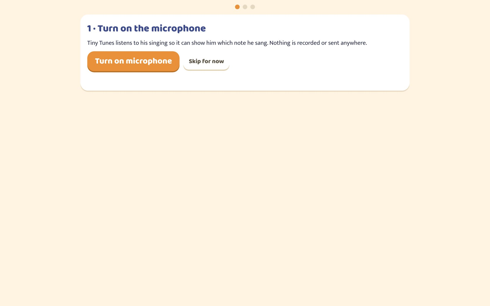

## 2. First start: find Sa
He (or you) sings one long comfortable note. The app shows which note it is (here D#) and that becomes Sa. Or tap "Skip: use D".
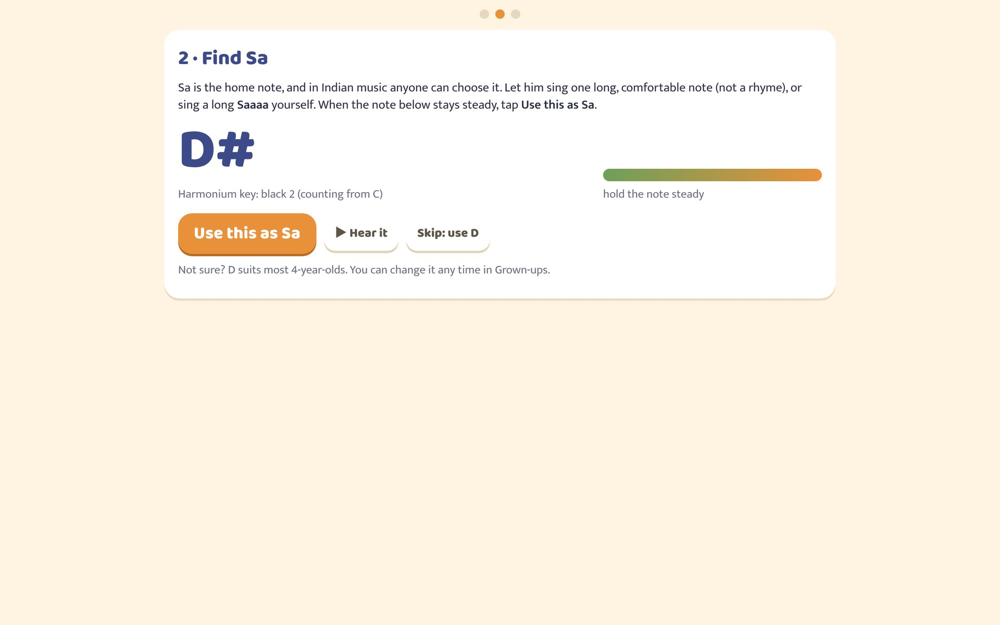

## 3. First start: the singing voice
The lessons are sung by a real man's voice (Sa, Re, Ma, Dha). You can record a family member's voice for all notes later.
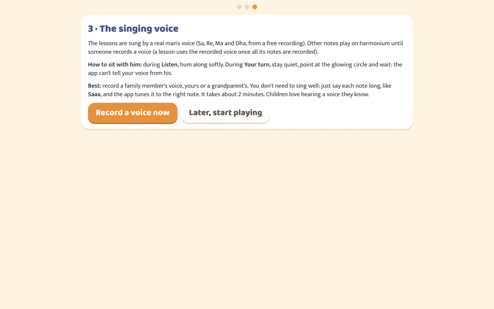

## 4. Home: the lessons
13 lessons, from "Sa" up to the full scale. The coloured dots are the notes in each lesson; stars show how often he has done it. The highlighted card is the next one (a lesson needs 2 stars before the next is suggested); later lessons are dimmed but can still be opened. The little person icon means a real voice sings that lesson.
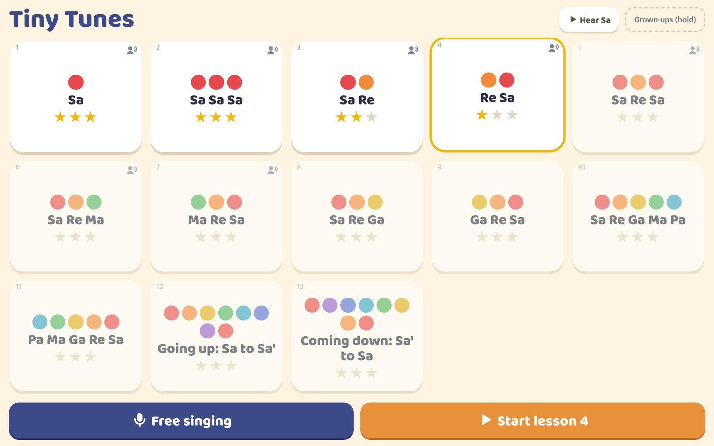

## 5. Lesson: listen
The voice sings "Sa Re Sa". Each bubble lights up as its note is sung, and the note line glows. The grey line under the bubbles tells the grown-up what to do.
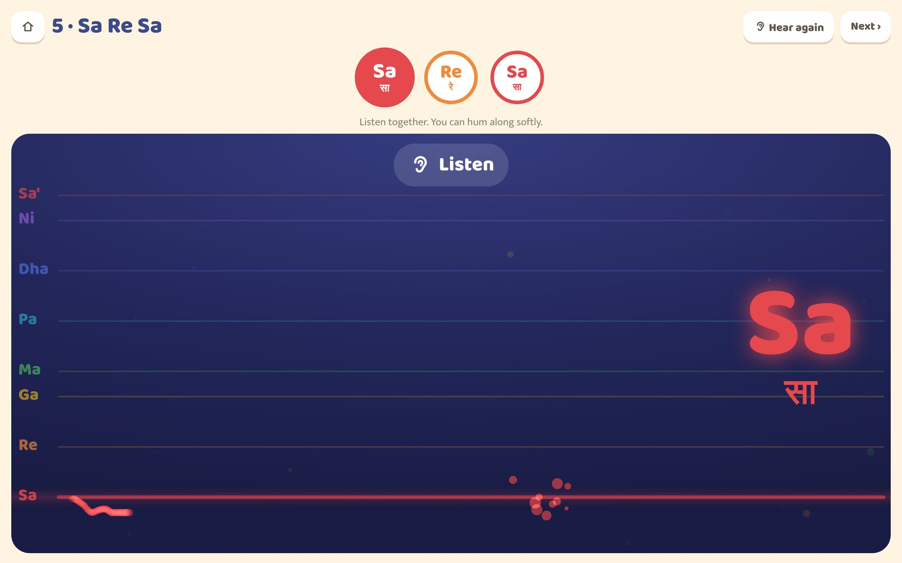

## 6. Lesson: his turn
His turn starts the moment the voice stops, so an immediate echo counts. The glowing ball follows his voice over the coloured lines. Here he has sung Sa (gold bubble) and is now on Re: the gold ring fills while he holds it. The phrase has to come in one go; if nothing right comes for about 6 seconds, the voice sings the whole phrase again at his next pause (twice at most, then the lesson ends kindly).
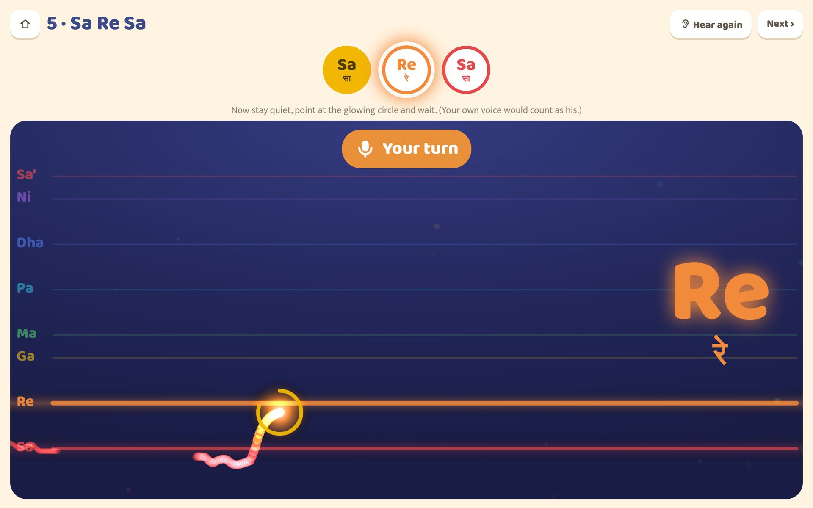

## 7. Lesson: done
If the phrase ended away from Sa, the voice sings Sa once, so the music comes home. Stars fall, and the app plays back the singing it heard (only the moments when someone was singing). Then: hear it again, do it again, or go to the next lesson.
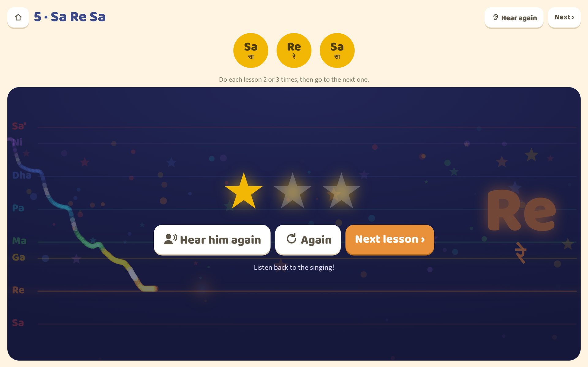

## 8. Free singing
No lesson: the ball follows whatever he sings and shows the note name. Holding Sa for about a second makes stars fall.
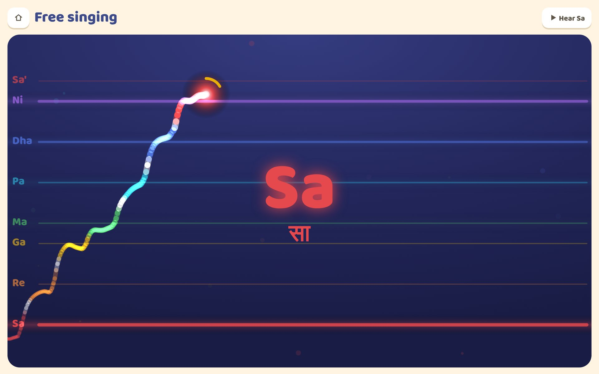

## 9. Record a voice (for grown-ups)
For each note, tap Record, listen to the harmonium, then say the note long (Saaa…). The app tunes it. Then ▶ plays the result. A lesson uses the recorded voice once all of its notes are recorded, so record all 8 with the same voice.
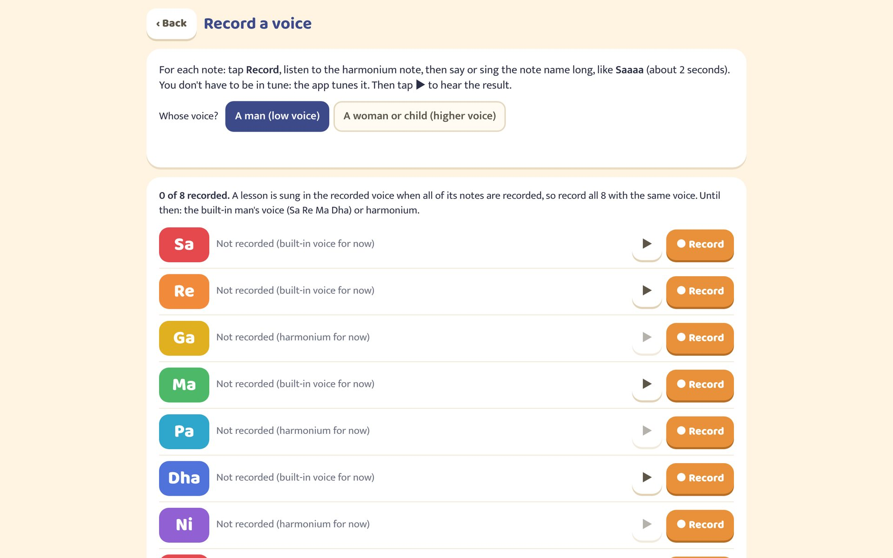

## 10. Grown-ups corner
Change Sa, how close counts, the app's volume, the tablet volume limit during music, tanpura on or off, and a microphone check. Opened by holding the "Grown-ups" button for 1.5 seconds.
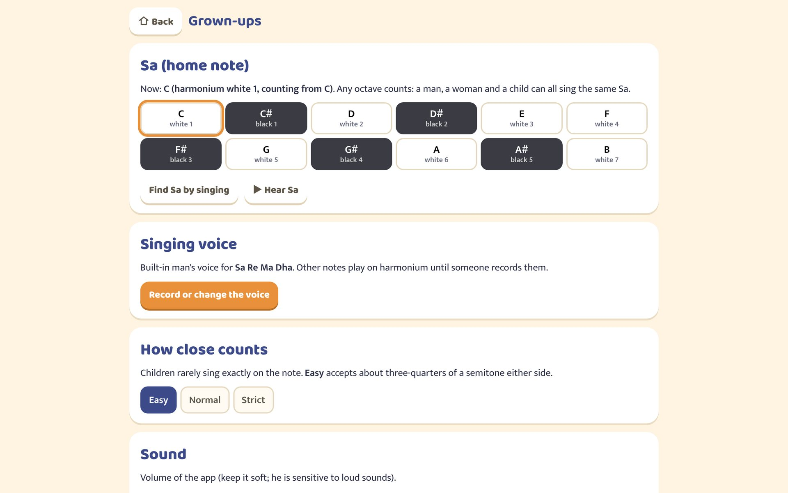

## 11. Tablet held upright
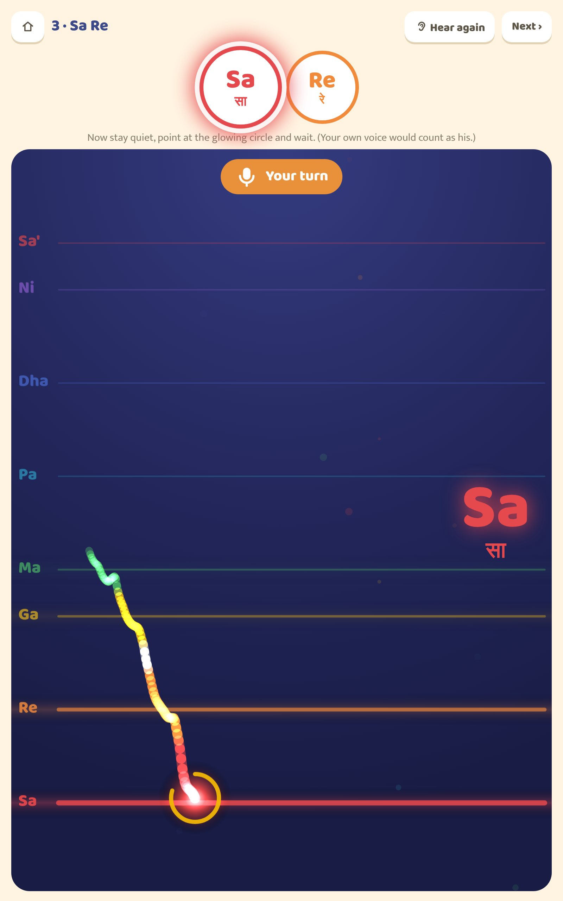
